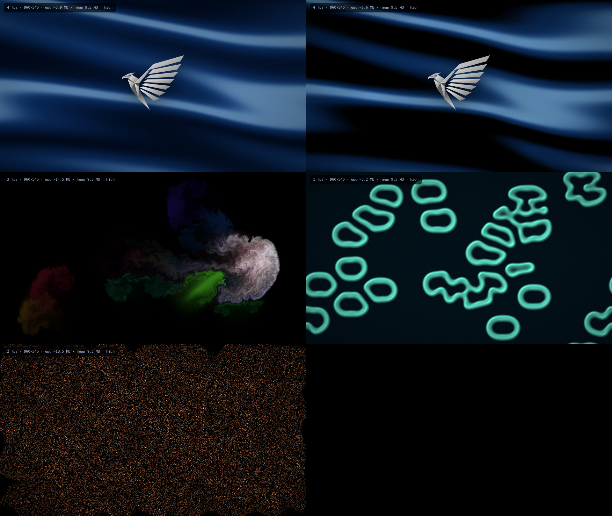

# Silk Engine 0.8.0 update

See [UPDATE-0.8.0.md](UPDATE-0.8.0.md) for changes, installation and validation limits.

# Silk Engine

*by ECHELON*

Live wallpapers and real-time GPU simulations behind your Windows desktop icons.
Videos, GIFs, images, web wallpapers, and four built-in simulations, with an OLED mode for any
display. It is built to cost almost nothing when you can't see it.



## Community setup

Discover is implemented below My wallpapers. Connect its shared online backend using [backend/SETUP.md](backend/SETUP.md). The shipped service config is empty; no live backend has been deployed.

## What it does

- **Wallpapers.** You can use any of these as a wallpaper:
  - Video: MP4, WebM, MOV and more.
  - Animated images: GIF, WebP, APNG.
  - Still images.
  - Web wallpapers: any folder with an `index.html`.
- **Simulations.**
  - **Living Silk** is the ECHELON silk shader, with an optional Icarus tunnel and the silver bird.
  - **Fluid Ink** is a real Navier–Stokes fluid. Ink follows your cursor and bursts on the beat.
  - **Reaction–Diffusion** grows Gray–Scott coral, cells and labyrinths, and you can draw on it.
  - **Flow Field** moves up to 1 million GPU particles along curl noise, leaving 16-bit light trails.
- **Multi-monitor.** Each display can show a different wallpaper, or you can span one across all of them.
- **OLED mode.** On any panel, near-black shadows go to true `#000` and highlights get an emissive pop. It also adds OLED-style vibrance and keeps black pixels free of dither speckle. There is an optional burn-in guard for real OLED screens.
- **Reactive.** It responds to system audio (WASAPI loopback) and to the cursor when it is over the desktop.
- **The ECHELON bird on anything.** Every wallpaper type, including your own videos and images, can show the bird, with size, position (centre or any corner) and opacity.
- **Widgets.** A screen editor with drag/resize, snapping, layers, per-monitor assignments, clock, date, calendar, system readings, text and four audio visualizer styles. Import supported Rainmeter meters from INI, folders, ZIP or RMSKIN packages with a compatibility report.
- **Studio app.** Same design language as the ECHELON Logbook: true black, dithered silver wave, liquid glass, large titles, a floating dock, a liquid-glass title bar and smooth transitions throughout.
  - A library you can drag files into.
  - A monitor map for choosing what plays where.
  - Settings for each wallpaper, and saved presets.
  - A tray menu and a start-with-Windows option.

## Why it's light

| Technique | What it saves |
|---|---|
| One window and one WebGL context cover every monitor | One renderer process instead of one per screen |
| Monitors showing the same wallpaper share one scene instance | It is rendered once and displayed many times |
| A screen covered by a maximised or fullscreen window stops rendering | GPU and CPU work for screens you can't see |
| When every screen has been covered for 10 s, buffers and decoders are freed and the WebView2 is suspended | Near-zero CPU and trimmed RAM while gaming |
| The Studio window is destroyed when closed, not hidden | No UI memory while the wallpaper runs from the tray |
| Simulations render small and are rebuilt at display resolution (Catmull-Rom bicubic, 10-bit buffers) | Native-looking quality at a fraction of the pixels |
| Bloom and OLED local contrast read the GPU mip chain | No extra passes or buffers |
| Animated images are decoded one frame at a time (ImageDecoder) | A long GIF uses about one frame of memory |
| Video frames are uploaded only when the decoder produces a new one | No redundant uploads at high refresh rates |
| Files are streamed in 2 MB byte ranges by the `wp://` protocol | Large videos are never read into memory |
| Event-driven frame loop | A static scene draws zero frames |
| On battery: eco quality at 24 fps, or pause (configurable) | Laptop battery |

The **Performance overlay** setting (Display tab) shows the live frame rate, buffer sizes and
estimated GPU memory.

## Upgrading from ECHELON Engine (0.2 and earlier)

The app was renamed in 0.3 and now has its own app id (`com.echelon.silk`), so Windows treats it
as a new app:

1. Quit ECHELON Engine from the tray, then uninstall it (Settings → Apps).
2. Install Silk Engine.

Your library and settings are copied across automatically on first launch.

## Build and run

You need:

- Windows 10 or 11
- [Rust](https://rustup.rs)
- Node.js 18 or later
- The Microsoft C++ Build Tools (the "Desktop development with C++" workload)

WebView2 is already part of Windows 10 and 11.

```bash
npm install
npm run dev      # run with hot reload
npm run build    # produces installers
```

The installers end up in `src-tauri/target/release/bundle/`:

- `nsis/Silk Engine_0.7.0_x64-setup.exe` is the recommended per-user installer and needs no admin rights.
- `msi/Silk Engine_0.7.0_x64_en-US.msi` is for managed or enterprise installs.

### Preview the renderer in a browser

`npm run preview` serves `src/` locally so you can work on the UI and simulations without Rust.
A mock backend stands in for the app:

1. Open `index.html` (the Studio) in one tab.
2. Open `renderer.html` in another tab. Add `?monitors=2` to fake two displays, or `?stats` to show the performance overlay.

The Studio tab drives the renderer tab live.

## Publishing

1. Push this folder to a GitHub repository.
2. Tag a release with `git tag v0.7.0 && git push --tags`.
3. `.github/workflows/release.yml` builds both installers on GitHub's Windows runners and attaches them to a **draft release**. Review the draft, then publish it.

The `check.yml` workflow runs clippy and the unit tests on every push.

Before you publish widely:

- **Code signing.** Unsigned installers trigger a SmartScreen "unknown publisher" warning. You can sign with an OV/EV certificate or Azure Trusted Signing; see Tauri's [Windows signing guide](https://v2.tauri.app/distribute/sign/windows/).
- **Auto-update (optional).** Add `tauri-plugin-updater` and a signing key so installed copies update themselves from your GitHub releases.
- **Rename it.** Change `productName`, `identifier` and the icons in `src-tauri/tauri.conf.json`. Regenerate the icons with `npx tauri icon your-logo.png`.
- **Microsoft Store (optional).** The MSI can be submitted through Partner Center.

## Web wallpaper API

Web wallpapers run sandboxed on their own origin (`wp.localhost`). They cannot call the app or
read files outside their own folder. The app injects a small runtime into every web wallpaper:

```js
echelon.onAudio(bands => { /* 32 log-spaced bands, 0..1 */ });
echelon.onCursor(({ x, y, down }) => { /* page coordinates */ });
echelon.onPause(paused => { /* stop animating when hidden */ });
```

Cursor input is also delivered as normal `mousemove`, `mousedown`, `mouseup` and `click` events.

**Wallpaper Engine compatibility.** These calls are provided, so most unpacked Wallpaper Engine
*web* wallpapers run as-is:

- `wallpaperRegisterAudioListener`, which receives 128 values (left and right channels).
- `wallpaperPropertyListener.applyUserProperties`, called with the defaults from `project.json`.
- `wallpaperPropertyListener.setPaused`.

To use one, add the wallpaper's folder with **Add web wallpaper**. Scene and video wallpapers from
Wallpaper Engine use its own proprietary formats and are not supported.

## Project layout

```
src/                       frontend (no bundler, plain ES modules)
  index.html, studio/      Studio: library, monitor map, settings
  renderer.html, renderer/ wallpaper renderer
    gl.js                  WebGL2 core and display-resolution composite (OLED, bicubic, dither)
    main.js                viewports, scheduler, input, hibernate, overlays
    scenes/                silk, fluid, reaction, particles, media
  shared/catalog.js        every setting, defined once (UI and renderer both read it)
  shared/bridge.js         Tauri API, or a mock backend in a plain browser
  shared/web-shim.js       runtime injected into web wallpapers
src-tauri/src/
  lib.rs                   commands, windows, tray, lifecycle
  desktop.rs               behind-the-icons attach (classic and 24H2), monitors, WebView2 suspend
  watcher.rs               covered-monitor detection, battery, cursor, layout, hibernation
  audio.rs                 WASAPI loopback, FFT, bands
  protocol.rs              wp:// streaming file server, restricted to library items
  config.rs                persistent library and settings
```

**Adding a setting:** add one line to `src/shared/catalog.js`. The Studio control appears
automatically, and the scene receives the value through `setSettings`.

**Adding a simulation:** write a class in `src/renderer/scenes/` with these methods:

- `resize`
- `setSettings`
- `update` (returns whether it is still animating)
- `render`
- `output`
- `dispose`

Then register it in `renderer/main.js` and `shared/catalog.js`, and add a built-in entry in
`config.rs`.

## Status

The 0.7.0 JavaScript regression suite and syntax checks pass locally. This update has not been compiled or visually tested here: the environment has no Rust/Windows toolchain or browser runtime. The Windows CI workflow runs Rust tests and Clippy.

See UPDATE-0.7.0.md for the Windows acceptance checks before publishing.

## Credits

The silver bird and the cobalt silk source were supplied by ECHELON. The silk shader descends from
React Bits Silk and the Echelon Project Room / Icarus.
