## v1.5.0 — Smooth interaction release

See [UPDATE-1.5.0.md](UPDATE-1.5.0.md) for changes, validation and the Windows release checklist. This package contains source; it does not contain a compiled installer.

<div align="center">


# Silk Engine

**Live wallpapers and real-time GPU simulations, living behind your Windows desktop icons.**

*by ECHELON*

[](https://github.com/apexrajveer-creator/Silk-Engine/actions/workflows/check.yml)


[](LICENSE)

[Features](#features) &nbsp;·&nbsp; [Built-in wallpapers](#built-in-wallpapers) &nbsp;·&nbsp; [The Studio](#the-studio) &nbsp;·&nbsp; [Install](#install) &nbsp;·&nbsp; [Build from source](#build-from-source) &nbsp;·&nbsp; [Web wallpapers](#web-wallpaper-api) &nbsp;·&nbsp; [Contributing](#project-layout)

<br>

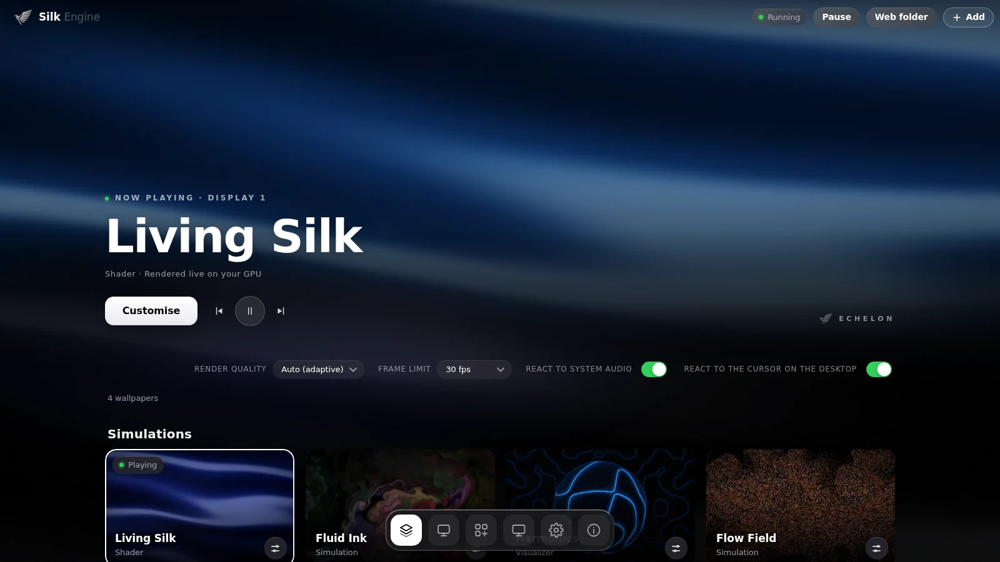

</div>

<br>

Silk Engine puts motion behind your work. Play a video, a GIF, a web page or one of the built-in
GPU simulations as your desktop wallpaper, on one monitor or all of them, with an OLED mode for
panels that deserve true black. It reacts to the music you're playing and to your cursor, and it is
designed to cost almost nothing when you can't see it.

The Studio, the app you use to choose and tune everything, shares one design language: true black,
liquid glass, large titles and a floating dock.

## Features

- **Any wallpaper.** Video (MP4, WebM, MOV and more), animated images (GIF, WebP, APNG), still
  images, and web wallpapers (any folder with an `index.html`). Most unpacked Wallpaper Engine *web*
  wallpapers run as they are.
- **Six built-in GPU wallpapers**, each with its own settings: Living Silk, Fluid Ink, Harmonics,
  Flow Field, Spectral Terrain and Cell Garden. See [below](#built-in-wallpapers).
- **Reacts to your music.** System audio is captured with WASAPI loopback (what you hear) and
  analysed into 32 log-spaced bands plus a live waveform, so wallpapers can pulse, flow and morph
  with the sound.
- **Reacts to your cursor** when it is over the desktop, with inertia and no snapping.
- **Global hotkeys.** Change wallpaper, pause, toggle OLED mode and more from any app, even while Silk
  Engine sits in the tray. Every shortcut is rebindable. See [Hotkeys](#hotkeys).
- **The island.** Rest the cursor at the top-centre of any screen and a small bar slides in with the time,
  CPU and memory. Click it and it opens into a glass panel with six tabs: quick settings (Wi-Fi, Bluetooth,
  volume), clipboard history, system stats, your most used apps, your wallpapers, and power. See
  [The island](#the-island).
- **Multi-monitor.** Each display can play something different, or one wallpaper can span them all.
- **OLED mode.** Near-black shadows go to true `#000`, highlights get an emissive pop, and an
  optional burn-in guard gently shifts pixels on real OLED screens.
- **Desktops.** Save a complete look (wallpapers, display settings, widget layout) as a profile and
  switch back any time, or build a playlist that rotates wallpapers on a timer, in order or shuffled.
- **Widgets.** Clock, date, calendar, system readings, text and audio visualizers, placed with a
  drag-and-resize editor with snapping, layers, undo and per-monitor assignment. Import Rainmeter
  skins (INI, folders, ZIP or RMSKIN) with a compatibility report.
- **Theme sync.** Optionally match the Windows accent colour (Start, taskbar highlights, title bars)
  to your wallpaper. In an RGB colour mode the taskbar goes dark grey instead of chasing the colours. Your
  own accent is saved first and restored when you switch it off.
- **The ECHELON bird on anything.** Any wallpaper, including your own videos and images, can carry
  the silver bird, with size, position and opacity.
- **Discover.** A community gallery you can connect to your own backend. See
  [backend/SETUP.md](backend/SETUP.md).
- **Looks after itself.** Start with Windows (it launches silently into the tray with the wallpaper
  running, the way Steam does: no console, no window), a tray menu, automatic pause when a window covers
  the screen, battery-aware performance, settings that save atomically and back up on demand.

## Built-in wallpapers

<table>
  <tr>
    <td width="33%" valign="top">
      <br>
      <b>Living Silk</b><br>
      <sub>The ECHELON silk shader: slow, glossy waves of cobalt cloth, with an optional Icarus drift tunnel and the silver bird.</sub>
    </td>
    <td width="33%" valign="top">
      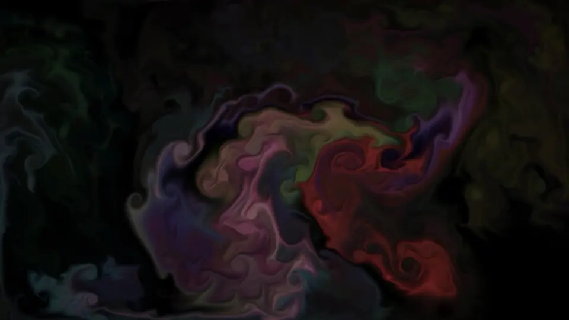<br>
      <b>Fluid Ink</b><br>
      <sub>A real Navier–Stokes fluid. Ink follows your cursor, drifts on its own and bursts on the beat.</sub>
    </td>
    <td width="33%" valign="top">
      <br>
      <b>Harmonics</b><br>
      <sub>Music made visible, as cymatics: sand gathering along the vibrating lines of a plate or sphere. More below.</sub>
    </td>
  </tr>
  <tr>
    <td width="33%" valign="top">
      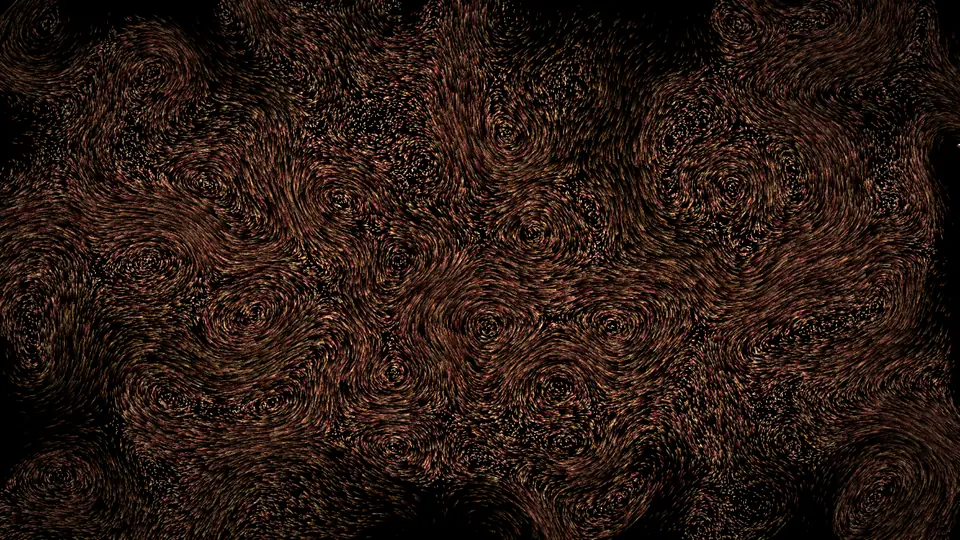<br>
      <b>Flow Field</b><br>
      <sub>Up to a million GPU particles riding curl noise, leaving 16-bit light trails.</sub>
    </td>
    <td width="33%" valign="top">
      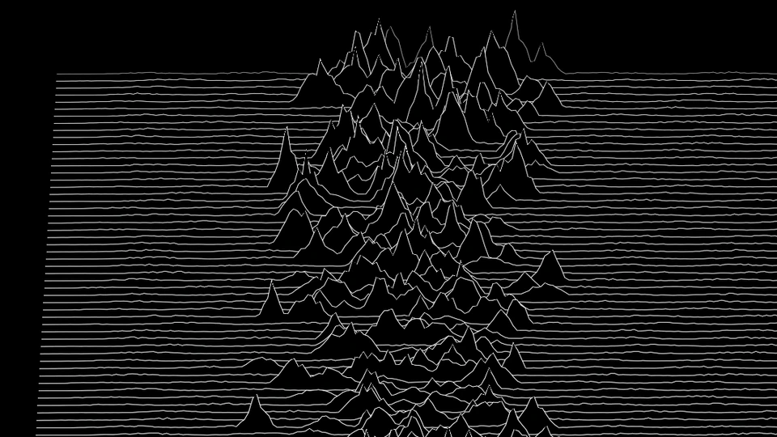<br>
      <b>Spectral Terrain</b><br>
      <sub>Your music as a ridgeline of hairlines, every row a moment of sound piling into mountains. More below.</sub>
    </td>
    <td width="33%" valign="top">
      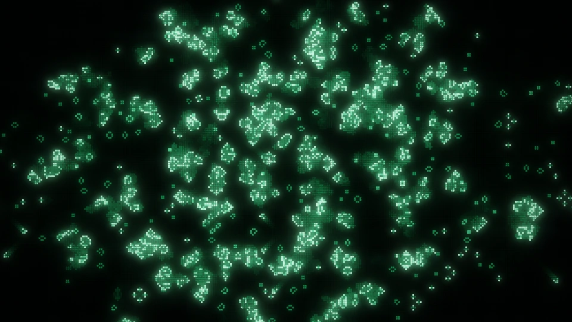<br>
      <b>Cell Garden</b><br>
      <sub>Conway's Game of Life as an arcade cabinet shot like a film. The music plants the garden. More below.</sub>
    </td>
  </tr>
</table>

### Harmonics

Harmonics turns the sound you're playing into geometry, and it looks complete in silence too.

<table>
  <tr>
    <td width="33%" valign="top">
      <br>
      <b>Cymatics, sphere</b><br>
      <sub>Sand settles along the nodal lines of spherical vibration on a slowly turning sphere, over a faint echo of the flat field.</sub>
    </td>
    <td width="33%" valign="top">
      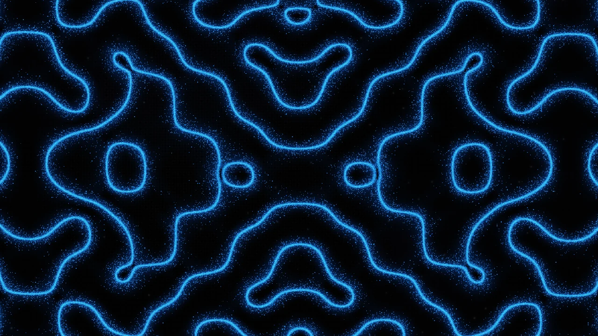<br>
      <b>Cymatics, full screen</b><br>
      <sub>A plate that fills the display. Each of twelve vibration modes is driven by its own slice of the spectrum.</sub>
    </td>
    <td width="33%" valign="top">
      <br>
      <b>Lissajous silk</b><br>
      <sub>Hundreds of hairline 3D Lissajous strands, a small phase step apart, folding like translucent silk.</sub>
    </td>
  </tr>
</table>

- **The sound shapes the pattern.** Pitch sets the scale (low sounds open into bold shapes, high
  sounds tighten into fine lace), every note nudges its part of the pattern, and beats make the field
  swell. When it is silent, the pattern drifts on slow, unrelated rhythms and never repeats.
- **Sharp at any resolution.** Lines are antialiased in the shader, so they stay crisp up to 4K.
- **Tunable.** Mode, plate, shape family, strand density, colour (blue, RGB reacting to the music,
  white, silver, ice, cobalt, violet, cherry, forest, amber or any custom colour), motion, line
  weight, glow, trail, audio response, stars and nebula, halftone background and brightness.

### Spectral Terrain

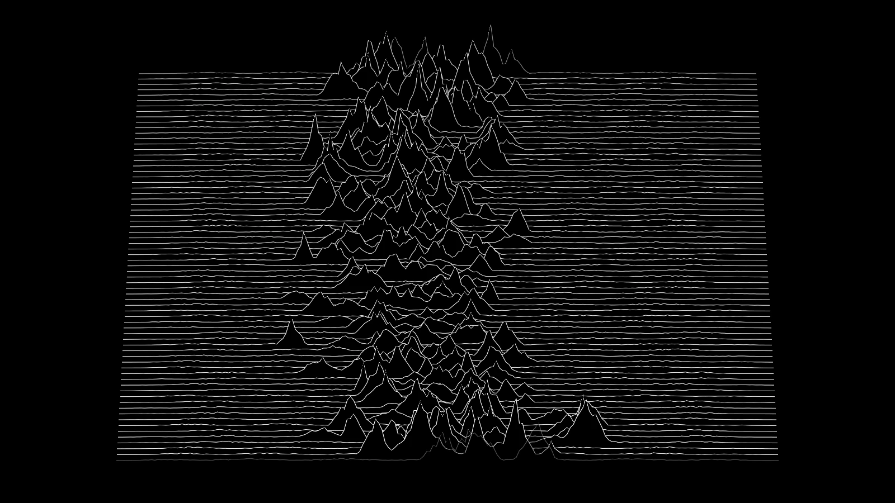

A ridgeline plot of what you're hearing, in the manner of a famous pulsar chart. Every row is a snapshot
of the spectrum a moment ago; the rows slide back into the distance, and each one hides the rows behind
it with a solid black fill, so loud passages pile up into mountains.

- **Alive in silence.** With nothing playing it keeps producing pulsar-style bursts, so it is never a dead screen.
- **Follows the music.** The spectrum decides where peaks appear and how tall they grow, and beats make
  them jump. Lows sit in the middle (pulsar layout) or on the left (spectrum layout).
- **Hairline sharp.** Lines are antialiased in the shader and drawn at your display's native resolution.
- **Tunable.** Layout, colour, row count, scroll speed, peak height, roughness, audio response, width,
  perspective, fade into the distance, peak highlight and line weight.

### Cell Garden

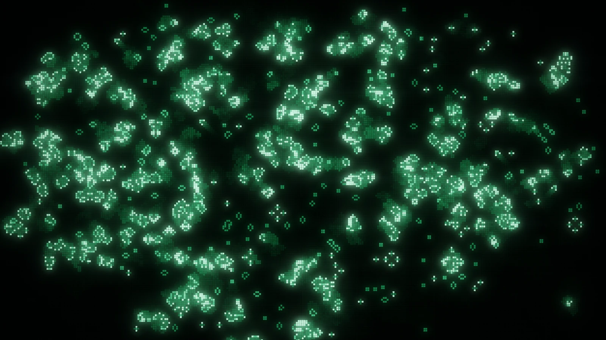

Conway's Game of Life, treated like an arcade cabinet that is also a film shot. A grid of glowing pixels
evolves on the GPU at a steady pace whatever your frame rate, and the picture cross-fades between generations,
so births brighten and deaths fade out instead of flickering.

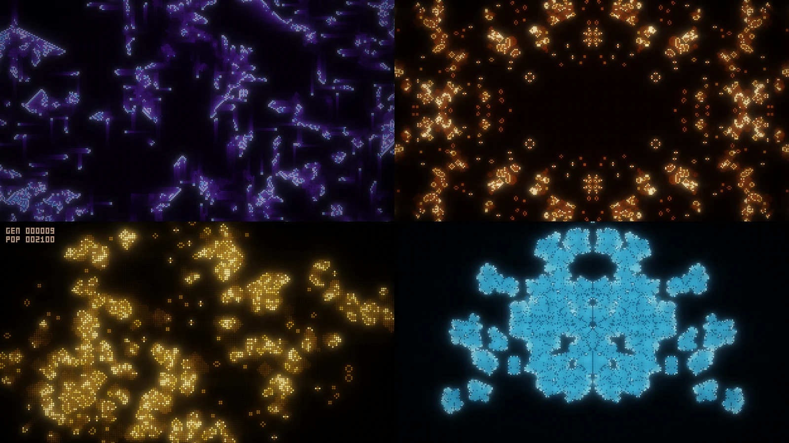

- **Six rule sets.** Classic Life, HighLife, Day & Night, Seeds, Coral growth and Brian's Brain (the
  three-state rule whose sparks stream across the screen like neurons).
- **The look.** Arcade squares, LED tiles or round dots over a faintly lit dead grid. Newborn cells flash
  white-hot and cool into a settled colour, and dead cells leave an afterglow. Palettes: phosphor green,
  amber terminal, arcade neon, Game Boy, embers, ice, cobalt, a slowly shifting RGB, or any colour.
- **The shot.** A tight bloom, a wide bloom with a touch of lens fringing, horizontal anamorphic streaks off
  the brightest cells, CRT scanlines, a vignette, a filmic highlight roll-off, and a slow camera drift with
  a small punch-in on the bass.
- **The music is the gardener.** Beats launch glider volleys, onsets plant famous long-lived patterns
  (the R-pentomino, the acorn, spaceships, now and then a glider gun), and bright sounds scatter sparks.
  Quiet passages keep a gentle gardener at work, and a check once a second replants anything that has died
  out or frozen, so it is never an empty screen.
- **Mandala mode.** Mirror left and right, or four-fold: every planting is mirrored and the rules are
  symmetric, so the whole garden stays an exact mandala.
- **Your cursor paints.** Hold to draw cells; click for a seed with four gliders flying out.
- **Arcade readout** (optional): generation and population in a pixel font, top left.
- **Tunable.** Rules, colour, pixel style, cell size, speed, mandala, edge wrapping, how strongly the music
  plants, afterglow, bloom, lens streaks, CRT, camera drift, unlit pixels and brightness.

## The island

Push the cursor to the **top-centre of a screen** and rest it there for a moment (a quarter of a second
by default): a small bar slides in with the time, CPU and memory. **Click it** and it opens into a panel with
six tabs. `Esc`, clicking somewhere else, or `Ctrl+Alt+Shift+I` closes it. It works on every monitor.

| Tab | What it does |
|---|---|
| **Quick** | A **media card** for whatever is playing (Spotify, a browser, VLC, Media Player: anything in Windows' media flyout) with its artwork, title, artist and app, a progress bar you can drag to seek, and previous, play/pause and next. Below it: Wi-Fi, Bluetooth, mute, pause wallpaper, OLED black and widgets in one compact row, the volume, and shortcuts into the Windows settings pages. A PC with no Bluetooth adapter says so and opens Settings instead; a player that cannot skip or seek has those controls dimmed. |
| **Clipboard** | The last 30 things you copied. Click one to copy it again. |
| **System** | Live CPU and memory with a one-minute chart, and how long Windows has been running. |
| **Apps** | The programs you use most, as bubble buttons with each program's own icon, its name, the time, and your share of time as a soft fill inside the bubble. Click one to start it. A program Windows has no icon for gets a neutral glyph. |
| **Wallpapers** | Your whole library with real thumbnails (your own videos and images included, made the same way the Studio makes them), the one playing marked, and previous, next, random and pause. |
| **Power** | Sleep, lock, sign out, restart and shut down. |

**It never gets in your way.** The bar needs a short rest at the edge, so flicking across it does nothing. It
never appears while you are dragging a window, or while a full-screen app, game or presentation is running.
It does not steal the keyboard from what you are typing into (it only takes focus once you click it open).
If you dismiss it, it will not pop back up until the cursor has left the edge and returned. Turn it off,
or change the delay, under **System → Island**.

**Privacy.** The clipboard history and the app tally are both **off until you turn them on**, inside the
island, and each says exactly what it keeps:

* *Clipboard history* is kept in memory only: never written to disk, gone when the app closes, wiped the moment
  you turn it off, text only, and anything a password manager copies is skipped (it honours the same two
  clipboard flags that Windows' own Win+V history does).
* *Apps* keeps only each program's file path and a number of seconds, in a small file on this PC. Never window
  titles, never what you type, never anything uploaded. Time when you are away from the keyboard is not counted.
  *Stop tracking* keeps the tally; *Clear* deletes it.

**Safety.** Sign out, restart and shut down need a second tap (the button turns red and says "Tap again to
confirm", and disarms itself after three seconds); the app refuses them unless they were confirmed. The page only
ever sends fixed names (`restart`, `network`, ...), never a command, path or address, and the island's commands
only accept calls from its own window.

*Honest limit:* the window is transparent, so the apps behind it are not blurred (only the operating system can do
that); the "liquid glass" look comes from translucent layers, a light rim, a highlight that follows the pointer and
the way the bar flows into the panel.

## When something goes wrong

* **A crash leaves a report.** If Silk Engine ever hits an internal error it writes a crash report (the newest
  five are kept) and a line in `silk-engine.log` (kept to 256 KB) in its settings folder, with your user folder
  replaced by `~`, and then starts itself again.
* **Safe mode.** After three crashes in a row, right after starting, it starts with simple settings (Living Silk,
  no hotkeys, widgets, audio or theme sync) and copies your own settings aside first. A banner offers **Restore my
  settings** or **Keep safe settings**. A crash after a long healthy run never triggers it.
* **Nothing absurd reaches a wallpaper.** Audio from the capture thread is cleaned once, at the door (every value
  between 0 and 1, exactly 32 bands), so one bad reading cannot freeze or poison a scene.

## The Studio

<table>
  <tr>
    <td width="50%">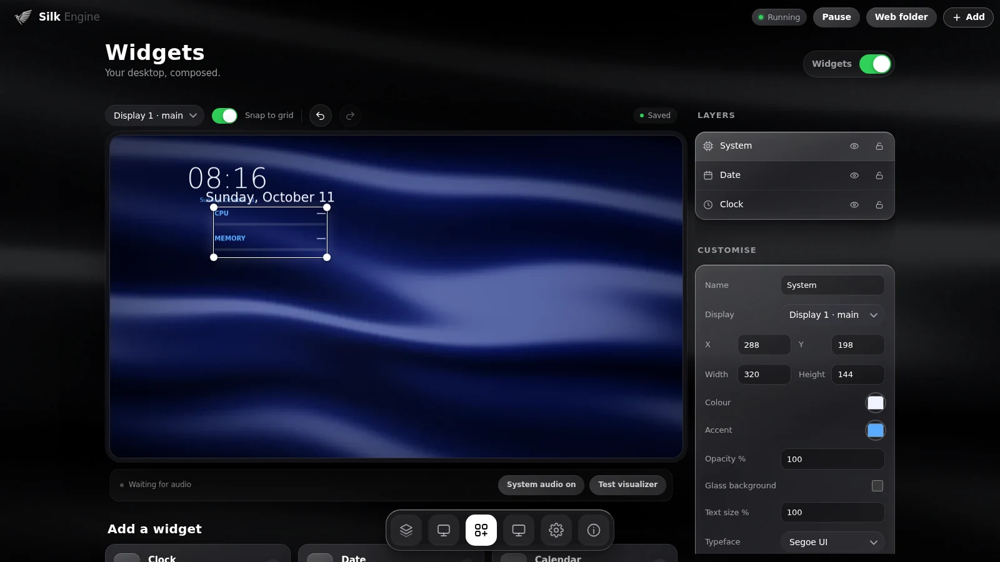<br><b>Widgets</b><br><sub>Compose your desktop on a monitor-framed preview, with layers and a live inspector.</sub></td>
    <td width="50%">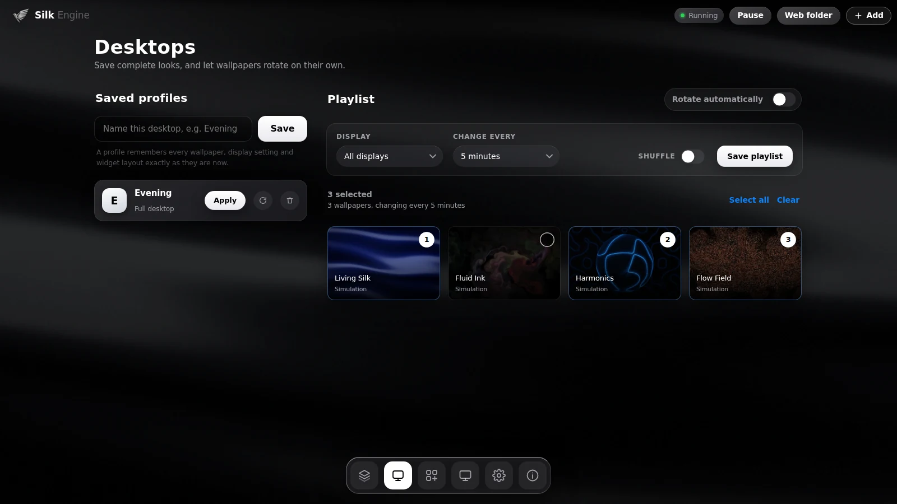<br><b>Desktops</b><br><sub>Saved profiles and a thumbnail playlist that numbers your picks.</sub></td>
  </tr>
  <tr>
    <td width="50%">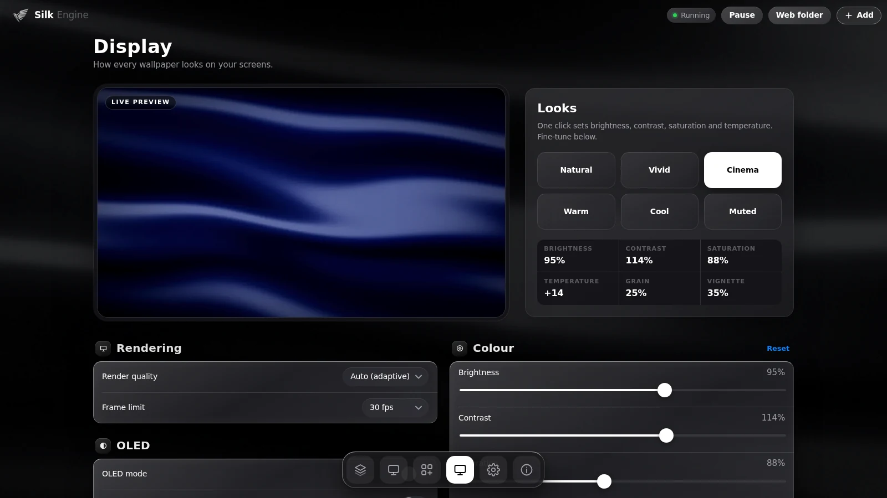<br><b>Display</b><br><sub>A live preview, one-click Looks (Natural, Vivid, Cinema, Warm, Cool, Muted) and fine control.</sub></td>
    <td width="50%">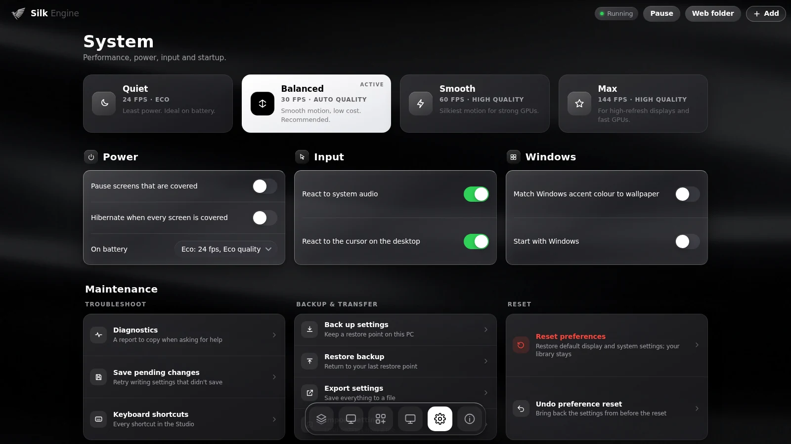<br><b>System</b><br><sub>Quiet, Balanced, Smooth and Max presets, power and input behaviour, backup and recovery.</sub></td>
  </tr>
</table>

**Keyboard.** `Alt+1`–`6` switch tabs · `Ctrl+F` search · `Ctrl+O` add files · `Ctrl+S` save the
workspace · arrow keys move through cards and the dock · `F2` opens a wallpaper's settings ·
`?` shows the full list.

### Hotkeys

These work from any app, even while Silk Engine is in the tray. Turn them off, or change any of them, in
**System → Hotkeys**: click **Change**, then press the keys you want.

| Action | Default | What it does |
|---|---|---|
| Next wallpaper | `Ctrl+Alt+Shift+→` | On every display |
| Previous wallpaper | `Ctrl+Alt+Shift+←` | On every display |
| Random wallpaper | `Ctrl+Alt+Shift+N` | A different one from your library |
| Pause or resume | `Ctrl+Alt+Shift+Space` | Freeze the wallpaper |
| Toggle OLED mode | `Ctrl+Alt+Shift+O` | True blacks on any screen |
| Brighter | `Ctrl+Alt+Shift+↑` | Display brightness +5 |
| Dimmer | `Ctrl+Alt+Shift+↓` | Display brightness -5 |
| Cycle render quality | `Ctrl+Alt+Shift+Q` | Auto, Eco, Balanced, High, Ultra |
| Toggle audio reactivity | `Ctrl+Alt+Shift+A` | React to system audio |
| Toggle cursor reaction | `Ctrl+Alt+Shift+C` | React to the cursor on the desktop |
| Open Silk Engine | `Ctrl+Alt+Shift+S` | Bring up the Studio |
| Open the island | `Ctrl+Alt+Shift+I` | The top-edge toolbar, on this screen |
| Show or hide widgets | `Ctrl+Alt+Shift+W` | All desktop widgets |
| Restart wallpaper | `Ctrl+Alt+Shift+R` | Reload the renderer |

`Apply desktop 1–5` jump to your saved desktops and have no default shortcut.

- **Safe by design.** A shortcut needs at least two of Ctrl, Alt, Shift and Win, so a hotkey can never take
  over `Ctrl+C` or a plain letter, and combinations Windows reserves (such as `Ctrl+Alt+Delete`) are refused.
- **Conflicts are shown.** If another app already owns a shortcut, it is marked **In use by another app**
  instead of silently doing nothing.
- On keyboards where `Ctrl+Alt` doubles as AltGr, a default may clash with typing some characters. Rebind it.

## Why it's light

| Technique | What it saves |
|---|---|
| One window and one WebGL context cover every monitor | One renderer process instead of one per screen |
| Monitors showing the same wallpaper share one scene instance | It is rendered once and shown many times |
| A screen covered by a maximised or fullscreen window stops rendering | GPU and CPU work for screens you can't see |
| When every screen has been covered for 10 s, buffers and decoders are freed and the WebView2 is suspended | Near-zero CPU and trimmed RAM while gaming |
| The Studio window is destroyed when closed, not hidden | No UI memory while the wallpaper runs from the tray |
| Simulations render small and are rebuilt at display resolution (bicubic, 10-bit buffers) | Native-looking quality at a fraction of the pixels |
| Animated images are decoded one frame at a time | A long GIF uses about one frame of memory |
| Video frames are uploaded only when the decoder produces a new one | No redundant uploads at high refresh rates |
| Files are streamed in 2 MB byte ranges by the `wp://` protocol | Large videos are never read into memory |
| Event-driven frame loop | A static scene draws zero frames |
| On battery: eco quality at 24 fps, or pause (configurable) | Laptop battery |

The **Performance overlay** (Display tab) shows the live frame rate, buffer sizes and estimated
GPU memory.

## Install

1. Download the latest `Silk Engine_x.y.z_x64-setup.exe` from the
   [Releases](https://github.com/apexrajveer-creator/Silk-Engine/releases) page. It installs per
   user and needs no admin rights. (An `.msi` is also provided for managed installs.)
2. Run it. WebView2 is already part of Windows 10 and 11.
3. Open **Silk Engine**, press **Add**, or drop files onto the Library, and pick what plays where.

> **Windows SmartScreen.** The installers are not code-signed yet, so Windows may show
> "Windows protected your PC". Choose **More info → Run anyway**.

**Upgrading from ECHELON Engine (0.2 and earlier).** The app was renamed in 0.3 and has its own app
id (`com.echelon.silk`), so Windows treats it as new: quit ECHELON Engine from the tray, uninstall
it, then install Silk Engine. Your library and settings are copied across on first launch.

## Build from source

You need Windows 10 or 11, [Rust](https://rustup.rs), [Node.js](https://nodejs.org) 22 (what CI
uses) and the Microsoft C++ Build Tools with the "Desktop development with C++" workload.

```bash
npm install
npm run dev      # run the app with hot reload
npm run build    # runs the checks, then produces the installers
```

The installers are written to `src-tauri/target/release/bundle/`:

- `nsis/Silk Engine_1.5.0_x64-setup.exe`: the recommended per-user installer.
- `msi/Silk Engine_1.5.0_x64_en-US.msi`: for managed installs. On Windows 11 24H2 the MSI step can
  fail because WiX needs VBScript, which is now an optional feature. Either enable it under
  *Settings → System → Optional features*, or build only the setup program with
  `npx tauri build --bundles nsis`.

**Start with Windows works in the installed app only.** A development build (`npm run dev`) keeps a console
window open and has no interface of its own without the dev server, so it refuses to register itself as a
startup item. If an older version did, the entry is removed the next time any build starts, and an installed
app rewrites its entry with the right path on every launch.

### Develop without Rust

`npm run preview` serves `src/` so you can work on the interface and the wallpapers in a browser. A
mock backend stands in for the app:

1. Open `index.html` (the Studio) in one tab.
2. Open `renderer.html` in another. Add `?monitors=2` to fake two displays, or `?stats` for the
   performance overlay.

The Studio tab drives the renderer tab live.

### Tests

```bash
npm run verify      # asset and version consistency
npm test            # unit tests (Node's built-in test runner)
npm run test:ui     # browser tests (Playwright; run `npx playwright install chromium` once)
npm run bench:ui    # reproducible UI benchmark: frame rate, scrolling, tab switches
npm run test:stress # renderer lifecycle stress test: rapid switching, hibernate and wake
cargo test --manifest-path src-tauri/Cargo.toml --lib
```

If Playwright's own browser download stalls on Windows, point the tests at Edge instead:

```bat
set "SILK_BROWSER_PATH=C:\Program Files (x86)\Microsoft\Edge\Application\msedge.exe"
npm run test:ui
```

### Releases

Pushing a tag such as `v1.5.0` runs `.github/workflows/release.yml`. It runs every check, builds the
installers on a Windows runner and attaches them to a **draft** GitHub release for you to review and
publish. The `check.yml` workflow runs the same checks, plus Clippy, on every push.

## Web wallpaper API

Web wallpapers run sandboxed on their own origin (`wp.localhost`). They cannot call the app or read
files outside their own folder. The app injects a small runtime into each one:

```js
echelon.onAudio(bands => { /* 32 log-spaced bands, 0..1 */ });
echelon.onCursor(({ x, y, down }) => { /* page coordinates */ });
echelon.onPause(paused => { /* stop animating when hidden */ });
```

Cursor input also arrives as ordinary `mousemove`, `mousedown`, `mouseup` and `click` events.

**Wallpaper Engine compatibility.** These calls are provided, so most unpacked Wallpaper Engine
*web* wallpapers run as they are: `wallpaperRegisterAudioListener` (128 values, left and right),
`wallpaperPropertyListener.applyUserProperties` (called with the defaults from `project.json`) and
`wallpaperPropertyListener.setPaused`. Add the wallpaper's folder with the **Web folder** button. Scene
and video wallpapers from Wallpaper Engine use its proprietary formats and are not supported.

## Project layout

```
src/                         frontend: no bundler, plain ES modules
  index.html, studio/        the Studio: library, desktops, widgets, display, system, about
  renderer.html, renderer/   the wallpaper renderer
    gl.js                    WebGL2 core and the display-resolution composite (OLED, bicubic, dither)
    main.js                  viewports, scheduler, input, hibernate, overlays, theme-sync sampling
    scenes/                  silk, fluid, lissajous (Harmonics), particles, terrain, life, media
  widgets/                   widget editor and the Rainmeter importer
  community/                 Discover gallery UI and client
  shared/
    catalog.js               every setting, defined once: the UI and the renderer both read it
    bridge.js                the Tauri API, or a mock backend in a plain browser
    web-shim.js              the runtime injected into web wallpapers
    hotkeys.js               hotkey actions and shortcut rules (a tested mirror of hotkeys.rs)
src-tauri/src/
  lib.rs                     commands, windows, tray, lifecycle
  desktop.rs                 attach behind the icons (classic and 24H2), monitors, WebView2 suspend
  watcher.rs                 covered-monitor detection, battery, cursor, layout, hibernation
  audio.rs                   WASAPI loopback, FFT, bands, waveform
  theme.rs                   Windows accent colour sync, with backup and restore
  hotkeys.rs                 system-wide hotkeys: action table, shortcut rules, the registration thread
  protocol.rs                wp:// streaming file server, restricted to library items
  config.rs                  persistent library and settings
backend/                     Supabase schema and setup for Discover
```

**Adding a setting.** Add one line to `src/shared/catalog.js`. The Studio control appears
automatically, and the scene receives the value through `setSettings`.

**Adding a wallpaper.** Write a class in `src/renderer/scenes/` with `resize`, `setSettings`,
`update` (return whether it is still animating), `render`, `output` and `dispose`. Register it in
`renderer/main.js` and `shared/catalog.js`, and add a built-in entry in `config.rs`.

## Status

The v1.5.0 source package has been checked with the available JavaScript tests. Windows compilation,
installer creation and desktop visual verification remain required. The included Windows CI workflow
is configured to run asset, unit, browser, Clippy and Rust checks; its presence is not a record of a completed run.

Things worth knowing:

- Still to be verified on more hardware: mixed-DPI multi-monitor setups, the Windows 11 24H2
  attach path, sleep and resume on varied machines, and global hotkeys inside exclusive-fullscreen games.
- Theme sync writes the same per-user registry values that Windows Settings writes. They are stable
  but undocumented, so check it on your machine before relying on it.
- Discover needs your own Supabase project; the shipped service config is empty. See
  [backend/SETUP.md](backend/SETUP.md).
- Installers are unsigned (see [Install](#install)).

## Credits

Created by **Rajveer Raj**. The silver bird and the cobalt silk source were supplied by ECHELON.
The silk shader descends from React Bits Silk and the Echelon Project Room / Icarus. The Harmonics
wallpaper (cymatics and Lissajous strands) was written for this project.

## License

[MIT](LICENSE) © 2026 ECHELON


### Circle to Search and compact Island update

Press **Ctrl + Shift + Alt + 0** (the top-row zero), or use **Circle to Search** in the Island's Quick section. Draw a freeform outline, release the mouse to preview the selection, then choose **Search with Lens**. Esc cancels; Redraw clears the selection. The shortcut is configurable in Settings → Hotkeys.

The compact Island now displays the clock, battery percentage (or AC on desktops), and a small system-audio visualizer. Its opening/tab transitions are faster, and both Island and search-overlay colors follow Silk's applied taskbar accent when theme sync is enabled. See [CIRCLE-SEARCH.md](CIRCLE-SEARCH.md) for behavior, privacy, limits and validation.
